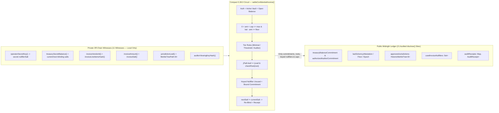
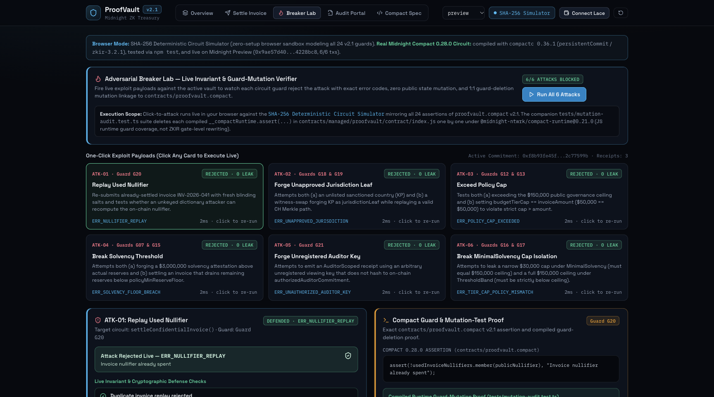

# ProofVault

**Confidential Invoice & Bounty Settlement with Selective-Disclosure Audit Receipts on Midnight Network**

[](./LICENSE)
[-34d399.svg)](./contracts/proofvault.compact)
[](./package.json)
[-34d399.svg)](./tests/mutation-audit.test.ts)
[-34d399.svg)](./deploy/preview.json)

> Built for **AKINDO — Build Privacy-First Apps on Midnight (Wave 3)** (`midnightntwrk`).
> - **Interactive Web App (SHA-256 Circuit Simulator + Adversarial Breaker Lab + Live Preview Reader):** [https://alphonshhhomenicmtu.github.io/proofvault-midnight/](https://alphonshhhomenicmtu.github.io/proofvault-midnight/)
> - **Live Midnight Preview Contract (v2.0, Ledger 9):** `0x9ae57d40331df50a9a30340d2f2a612f7e6cf8fa99112d11e630c7b3f4228bc8` (6/6 `SucceedEntirely` txs, blocks `#250,802`–`#250,861`, [`deploy/preview.json`](./deploy/preview.json))
> - **10-Slide Pitch Deck (PDF):** [`docs/proofvault-deck.pdf`](./docs/proofvault-deck.pdf)
> - **Demo Video (1080p):** [https://www.youtube.com/watch?v=2SAttW3TaCU](https://www.youtube.com/watch?v=2SAttW3TaCU)
> - **Privacy Boundary & `disclose()` Audit:** [`PRIVACY_BOUNDARY.md`](./PRIVACY_BOUNDARY.md)

ProofVault lets a DAO or foundation treasury settle contributor bounties and vendor invoices while proving four compliance properties on Midnight:

1. **Solvency above reserve floor:** committed reserves stay at or above `policyMinReserveFloor` after payout, and operator-authenticated solvency claims persist on-chain.
2. **Strict budget-tier compliance (`0 < amount < budgetTierCap <= policyMaxSingleSettlement`):** exact payout amounts are strictly below the disclosed cap so a prover cannot leak an exact payout as a public bound.
3. **Bound non-sanctioned jurisdiction membership:** the counterparty's ISO jurisdiction leaf is proven inside `approvedJurisdictions: HistoricMerkleTree<8, Bytes<32>>` **and** committed directly inside `invoiceCommitment`.
4. **Dictionary-resistant replay protection:** nullifiers are keyed with a secret blinding salt derived from `operatorSecretKey()` so an outside observer cannot grind low-entropy vendor names against `usedInvoiceNullifiers`.

**Honest scope & trust boundaries upfront:**
- The **treasury operator** sees all private witnesses in cleartext locally and is operationally trusted to match off-chain wires/payouts to the committed `invoiceAmount` (native Zswap shielded transfers are planned for v3).
- The **public ledger** sees commitments, secret-keyed nullifiers, historic Merkle roots, epoch/pause state, persisted solvency floors, and a tier-enforced `budgetTierCap`. Jurisdiction privacy equals the anonymity set of registered leaves (`2` leaves on the live Preview v2.0 contract; `8` leaves in the browser simulator; `HistoricMerkleTree` is append-only in v2.1).
- The **GitHub Pages app** runs a **SHA-256 Deterministic Circuit Simulator** (`src/midnight/proofEngine.ts`) so judges can test settlements, selective-disclosure tiers, and the **Adversarial Breaker Lab** immediately without Docker or a wallet. The real **Midnight Compact 0.28.0 contract** (using Compact's native `persistentHash`/`persistentCommit` builtins and `zkir-3.2.1`) runs in `npm test` via `@midnight-ntwrk/compact-runtime@0.21.0` and is deployed live on Midnight Preview.

---

## What Changed in v2.1 (Cryptographic & Circuit Hardening)

- **Secret-keyed anti-replay nullifiers (`deriveNullifierBlindingSalt` + `deriveNullifier`):** Replaced unkeyed `H(vendorId, lineItemsHash)` with `H("proofvault:nullifier:v2", H("proofvault:nullifier-salt:v2", operatorSecretKey), vendorId, lineItemsHash)`. Stops dictionary attacks over public bounty boards and makes nullifiers unlinkable across distinct treasuries while preserving deterministic anti-replay.
- **Jurisdiction leaf bound to invoice commitment:** `deriveInvoiceCommitment` now absorbs `jurisdictionLeaf` directly alongside `(vendorId, lineItemsHash, H(amount))` under `invoiceSalt`, while `assert(jPath.leaf == jLeaf)` pins the Merkle opening to that exact committed leaf.
- **Strict `cap > amount` bound:** Enforces `assert(amount < publicCap)` instead of `<=`, eliminating exact-amount leakage via `budgetTierCap == amount`.
- **Distinct disclosure-tier circuit rules:**
  - `MinimalSolvency`: requires `publicCap == policyMaxSingleSettlement` (no custom narrow band leaked) and zeroes `auditorTag`.
  - `ThresholdBand`: requires `publicCap < policyMaxSingleSettlement` (strictly narrower budget band) and zeroes `auditorTag`.
  - `AuditorScoped`: requires `deriveAuditorCommitment(auditorViewingKeyHash()) == authorizedAuditorCommitment` (rejects arbitrary/unregistered auditor keys) and emits a key-bound `auditorTag` MAC.
- **Authenticated, persisted solvency state:** `proveTreasurySolvency` now checks `operatorSecretKey()` and writes `lastSolvencyAttestation`, `lastSolvencyFloor`, and `lastSolvencyEpoch` into public ledger state.
- **Fresh treasury blinding salt:** Asserts `nextTreasuryBlindingFactor() != treasuryBlindingFactor()` on every settlement.
- **Adversarial Breaker Lab (`Breaker Lab` tab):** Interactive 1-click exploit harness letting judges fire **Replay Used Nullifier**, **Forge Unapproved Jurisdiction Leaf**, **Exceed Policy Cap**, **Break Solvency Threshold**, **Forge Unregistered Auditor Key**, and **Break MinimalSolvency Cap Isolation** live and inspect exact error codes, zero public state mutation, and 1:1 linkage to the 24 compiled JS guard-deletion mutants.

---

## Compact Compilation & Real Compiler Output

```bash
compact compile contracts/proofvault.compact contracts/managed/proofvault
```

Verified with `compactc 0.36.1` (`commit 7fa3a117c`, language `0.28.0`, `zkir-3.2.1`):

```text
Compiling 5 circuits:
# Exit 0 — artifacts written to contracts/managed/proofvault/
# contracts/proofvault.compact SHA-256: fc0ac33e60d3c69769b9d501a5a5eee178fcd49ed44360675b87a852625f4a2a
# contracts/managed/proofvault/contract/index.js SHA-256: b32e86c309610e9fd16804a2fdd1465b22218b24790acf17ab0baea83f3e46fc
```

### Compiled v2.1 Circuits (`contracts/managed/proofvault/compiler/contract-manifest.json`)

| Exported Circuit | ZKIR Size | BZKIR Size | Verifier Key | Prover Key | Role |
| --- | ---: | ---: | ---: | ---: | --- |
| `settleConfidentialInvoice` | 24,040 B | 7,445 B | 2,121 B | 86.0 MB | Atomic settlement: operator auth, balance opening, strict `amount < cap <= max`, reserve floor, tier rules, bound Merkle jurisdiction, keyed nullifier, auditor registration, salt freshness, `AuditReceipt` |
| `proveTreasurySolvency` | 6,400 B | 1,755 B | 2,121 B | 21.5 MB | Operator-authenticated solvency proof persisting `lastSolvencyAttestation`, `lastSolvencyFloor`, and `lastSolvencyEpoch` on-chain |
| `registerApprovedJurisdiction` | 3,433 B | 964 B | 2,121 B | 10.8 MB | Operator-authenticated leaf append to `HistoricMerkleTree<8, Bytes<32>>` |
| `updateGovernancePolicy` | 3,606 B | 1,053 B | 2,121 B | 10.8 MB | Operator-authenticated cap/floor update, active/paused circuit breaker, and epoch increment |
| `verifyReceiptOnChain` | 969 B | 266 B | 1,353 B | 0.2 MB | Public lookup helper checking membership in `auditReceipts` |

---

## Disclosed vs. Witness-Kept Boundary



| Field | Classification | Where Exercised in Demo |
| --- | --- | --- |
| `invoiceAmount()`, `treasurySecretBalance()`, `invoiceVendorId()`, `jurisdictionLeaf()`, `operatorSecretKey()` | **Witness-kept (private)** | Private Witness Vault (`Overview`), Settlement Form (`Settle Invoice`), and serialized `ContractState` zero-leak tests (`npm test`) |
| `treasuryBalanceCommitment`, `usedInvoiceNullifiers`, `AuditReceipt.budgetTierCap`, `AuditReceipt.jurisdictionRoot`, `lastSolvencyFloor` | **Disclosed (public ledger)** | Public Ledger State (`Overview`), Disclosed Diff (`Settle Invoice`), Exported JSON Verifier & Live Preview Indexer (`Audit Portal`) |

Full line-by-line inventory of all 11 witnesses and all 21 `disclose(...)` call sites is in [`PRIVACY_BOUNDARY.md`](./PRIVACY_BOUNDARY.md).

---

## Live Midnight Preview (Ledger 9) Deployment

ProofVault's **v2.0** Compact 0.28.0 contract is deployed and verified live on **Midnight Preview** (`protocolVersion: 2001100`, Proof Server `9.0.2`) with **6 confirmed `SucceedEntirely` transactions**. The hardened **v2.1** circuit is compiled with `compactc 0.36.1` and verified locally across all 24 guards via `@midnight-ntwrk/compact-runtime@0.21.0` (`npm test` + `npm run deploy:preview:dry`).

- **Live Midnight Preview Contract Address (v2.0):** `0x9ae57d40331df50a9a30340d2f2a612f7e6cf8fa99112d11e630c7b3f4228bc8`
- **Live Indexer GraphQL v4 Endpoint:** `https://indexer.preview.midnight.network/api/v4/graphql` (public CORS, zero auth)
- **Final On-Chain Serialized State:** `11,697 bytes` (`settledInvoiceCount = 1`, `currentEpoch = 1`, `treasuryBalanceCommitment = 0xad62d127ef1ac13d4a73c26d995bb6ddd0fab47d23619dd04ac588c15146fc26`)
- **Manifest:** [`deploy/preview.json`](./deploy/preview.json)

| # | On-Chain Circuit / Action | Preview Block | Confirmed Transaction Hash (`SucceedEntirely`) | Public On-Chain Effect |
| :---: | --- | ---: | --- | --- |
| 1 | `ContractDeploy` | `#250,802` | `0xa952332ea1c3680295a853ad1ec4ede82ae1e82f9dcda0e61630f7db15264747` | Deployed `proofvault.compact` (v2.0) with initial balance commitment & governance policy |
| 2 | `registerApprovedJurisdiction(CH)` | `#250,831` | `0x92d830abe80c3df4c0b245aab6c8c0d5649de782a97f615c2e76a99922c3fb21` | Inserted `iso:CH` leaf into `HistoricMerkleTree<8, Bytes<32>>` |
| 3 | `registerApprovedJurisdiction(SG)` | `#250,838` | `0xad9189709834908fa9ccd5cbbd9f06a3426f6dc8d0749f047fcd2cee9c2370fb` | Inserted `iso:SG` leaf (2-leaf tree on Preview = 1-of-2 anonymity set) |
| 4 | `proveTreasurySolvency` | `#250,844` | `0x743afa89e518f514353752b970fe66341bec8b4b2b5c97eb23ee7873200c12ba` | Proved reserves above public `$2.00M` floor (`0x90264f76...afce656`); exact balance shielded |
| 5 | `settleConfidentialInvoice` | `#250,852` | `0xc60a81d352fcb277c4b187bea22757df339d2c8c096af0490b491a97feb2e059` | Wrote `AuditorScoped` receipt `0xfa1ccd4f...4516822` under `$50,000` cap; exact payout shielded |
| 6 | `verifyReceiptOnChain(receiptId)` | `#250,861` | `0x0043a6dcb17177b8b3b4d291b078bbac4284222de67763d2b38be532f2ac3d4b` | Returned `true` confirming receipt membership in on-chain `auditReceipts` |

> **Walletless Live Verification:** Run `npm run verify:onchain` in your terminal or open the **Audit Portal** on GitHub Pages and click **"Verify Live On-Chain State"** (pre-filled with `0x9ae57d40331df50a9a30340d2f2a612f7e6cf8fa99112d11e630c7b3f4228bc8`).

---

## Application Screenshots

| Overview & Dual-Ledger Split | Adversarial Breaker Lab (Live 1-Click Exploits) |
| :---: | :---: |
|  |  |

| Confidential Settlement & Disclosure Diff | Live Preview Indexer & Auditor Verifier |
| :---: | :---: |
|  |  |

---

## Judge Quickstart & Verification

Three clearly separated layers:
1. **Browser SHA-256 Deterministic Circuit Simulator (GitHub Pages default):** Models all 24 v2.1 circuit invariants, selective-disclosure tiers, and the **Adversarial Breaker Lab** using `@noble/hashes/sha256` with zero Docker or wallet setup.
2. **Real Compiled Compact 0.28.0 Runtime (`npm test` & `npm run deploy:preview:dry`):** Executes `contracts/managed/proofvault/contract/index.js` directly against `@midnight-ntwrk/compact-runtime@0.21.0` (`persistentCommit` / `persistentHash` builtins).
3. **Live Midnight Preview Indexer GraphQL v4 (`Audit Portal` & `npm run verify:onchain`) + Lace/1AM Connector (`@midnight-ntwrk/dapp-connector-api@4.1.0`):** Queries `indexer.preview.midnight.network/api/v4/graphql` live without a wallet; when a Lace or 1AM browser wallet is installed, supports `balanceUnsealedTransaction -> submitTransaction` when given an unsealed Ledger 9 tx, or `signData` over the local simulator receipt ID as a wallet connectivity check.

### Run All Tests (62 Tests Across 5 Suites)
```bash
npm install
npm test
```

- `tests/mutation-audit.test.ts` (**32 tests**): Maps all **24/24 `assert(...)` guards** in `contracts/proofvault.compact` v2.1 to compiled `__compactRuntime.assert(...)` calls in `contracts/managed/proofvault/contract/index.js`, deletes each guard one by one to verify 24/24 compiled JS guard mutants are killed, plus 7 `fast-check` property-based fuzz suites.
- `tests/compact-contract.test.ts` (**9 tests**): Runs the real compiled v2.1 contract via `@midnight-ntwrk/compact-runtime@0.21.0` — secret-keyed nullifier dictionary resistance, bound jurisdiction leaf & leaf-swap defense, strict `cap > amount`, distinct tier enforcement, authenticated persisted solvency state, fresh blinding salt, and serialized `ContractState` zero-leak checks (including raw `Uint<64>` exact payout scan).
- `tests/proof-engine.test.ts` (**8 tests**): Validates the browser SHA-256 simulator, all 6 UI presets, zero-PII receipt exports, v2.1 hardening invariants, and all 6 **Adversarial Breaker Lab** attacks (including Replay Used Nullifier, Forge Unapproved Jurisdiction Leaf, Exceed Policy Cap, and Break Solvency Threshold).
- `tests/indexer-client.test.ts` (**7 tests**): Validates live Midnight GraphQL v4 queries, `ContractCall` parsing, HTTP 410 Preprod Blockfrost migration handling, `project_id` headers, and live Preview constants.
- `tests/wallet-adapter.test.ts` (**6 tests**): Validates Lace/1AM CAIP-372 discovery, `hintUsage`, DUST hydration, `balanceUnsealedTransaction -> submitTransaction`, `signData` wallet check, and `KeyMaterialProvider`.

### Verify Live Preview Chain & Build Artifacts
```bash
npm run verify:onchain       # Live GraphQL v4 check against indexer.preview.midnight.network
npm run deploy:preview:dry   # v2.1 artifact SHA-256 check + live chain probe + compiled runtime lifecycle
npm run build                # tsc --noEmit && vite build -> dist/
npm run build:deck           # Re-renders docs/proofvault-deck.pdf (10 widescreen slides)
```

---

## Repository Structure

```text
├── contracts/
│   ├── proofvault.compact                 # Midnight Compact 0.28.0 v2.1 contract (24 audited guards)
│   └── managed/proofvault/                # Real compactc 0.36.1 outputs (JS, d.ts, ZKIR/BZKIR, manifest)
├── deploy/
│   ├── preview.json                       # Live Preview v2.0 deployment (6/6 txs) + v2.1 artifact digests
│   └── preprod.json                       # Preprod Blockfrost deployment manifest (v2.1 digests)
├── docs/
│   ├── proofvault-deck.pdf                # 10-slide visual pitch deck (PDF)
│   ├── PITCH_DECK.md                      # Deck outline
│   └── screenshots/                       # Retina UI verification screenshots (incl. Breaker Lab)
├── scripts/
│   ├── deploy-testnet.mjs                 # Compiled runtime lifecycle & Preview/Preprod deploy harness
│   ├── verify-onchain.mjs                 # Walletless Midnight Preview Indexer GraphQL CLI verifier
│   └── build-deck.mjs                     # Reproducible headless Chrome 10-slide PDF deck generator
├── src/
│   ├── midnight/
│   │   ├── types.ts                       # Dual-ledger, Breaker Lab, wallet & indexer types
│   │   ├── proofEngine.ts                 # Browser SHA-256 Deterministic Circuit Simulator & 7-pt verifier
│   │   ├── adversarialLab.ts              # 6 live 1-click Adversarial Breaker Lab exploit scenarios
│   │   ├── indexerClient.ts               # Live Midnight Preview / Preprod Indexer GraphQL v4 client
│   │   ├── walletAdapter.ts               # Lace & 1AM dapp-connector-api v4.1 connector
│   │   ├── presets.ts                     # Seeded simulator vault & 6 scenarios
│   │   └── compactSource.ts               # Compiled v2.1 circuit stats & raw Compact source
│   └── components/
│       ├── OverviewTab.tsx                # Dual-ledger split view & authenticated solvency prover
│       ├── SettleTab.tsx                  # Confidential settlement form & simulator disclosure diff
│       ├── BreakerLabTab.tsx              # Interactive Adversarial Breaker Lab (1-click attack cards)
│       ├── AuditTab.tsx                   # Live Midnight Preview Indexer GraphQL & receipt verifier
│       └── CompactSpecTab.tsx             # v2.1 compiler stats, Merkle registry, governance & source
├── tests/
│   ├── mutation-audit.test.ts             # 24/24 compiled JS guard-deletion mutants + 7 fast-check suites
│   ├── compact-contract.test.ts           # Compiled Compact 0.28.0 runtime & zero-leak audit tests
│   ├── proof-engine.test.ts               # Browser SHA-256 simulator & Adversarial Breaker Lab tests
│   ├── indexer-client.test.ts             # Live Midnight GraphQL v4 client tests
│   └── wallet-adapter.test.ts             # Lace & 1AM connector tests
├── PRIVACY_BOUNDARY.md                    # 11-witness & 21-disclose() audit + honest threat model
├── SPEC.md                                # Wave 3 technical specification
└── LICENSE                                # Apache License 2.0
```

---

## License

Licensed under the **Apache License, Version 2.0**. See [`LICENSE`](./LICENSE) for full terms.
