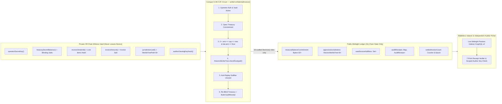
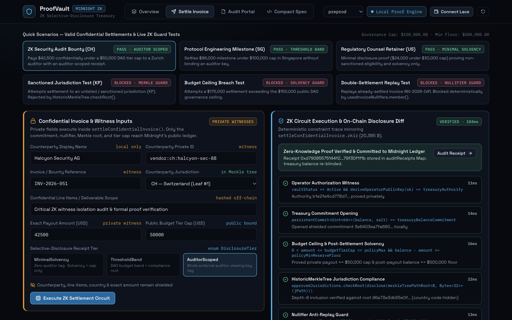
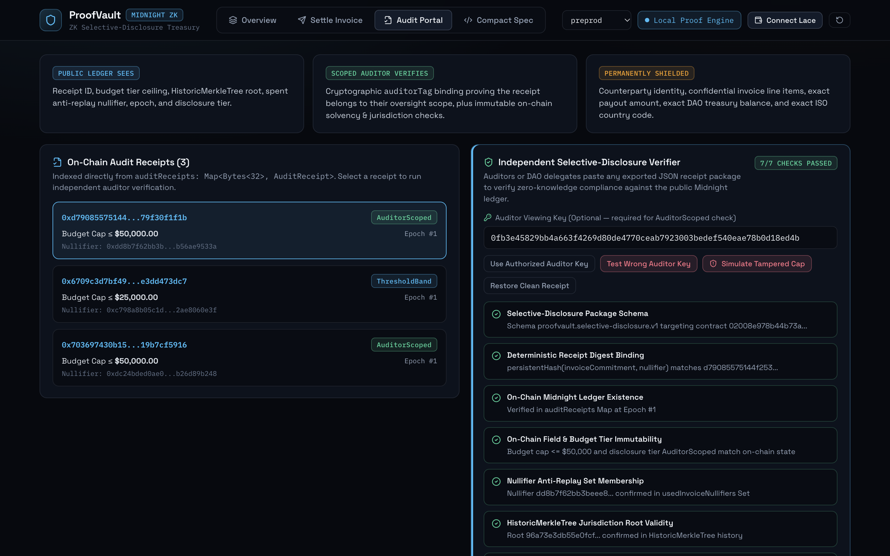
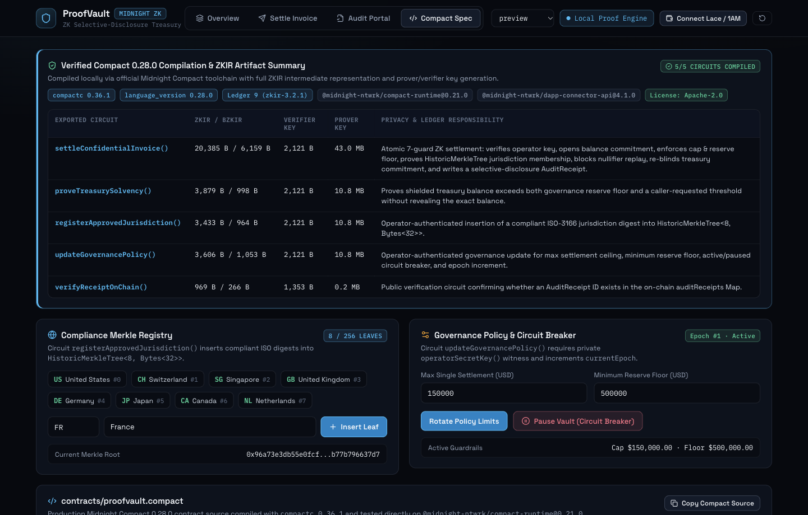

# ProofVault

**Zero-Knowledge Selective-Disclosure Treasury Compliance & Confidential Invoice / Bounty Settlement on Midnight Network**

[](./LICENSE)
[-34d399.svg)](./contracts/proofvault.compact)
[](./package.json)
[](./src/midnight/walletAdapter.ts)
[-34d399.svg)](./tests/mutation-audit.test.ts)
[-34d399.svg)](./deploy/preview.json)

> Built for **AKINDO — Build Privacy-First Apps on Midnight (Wave 3)** (`midnightntwrk`).
> - **Live App (GitHub Pages):** [https://alphonshhhomenicmtu.github.io/proofvault-midnight/](https://alphonshhhomenicmtu.github.io/proofvault-midnight/)
> - **Live Midnight Preview Contract (Ledger 9):** `0x9ae57d40331df50a9a30340d2f2a612f7e6cf8fa99112d11e630c7b3f4228bc8` (6/6 confirmed txs, blocks `#250,802`–`#250,861`, [`deploy/preview.json`](./deploy/preview.json))
> - **10-Slide Institutional Pitch Deck (PDF):** [`docs/proofvault-deck.pdf`](./docs/proofvault-deck.pdf)
> - **Narrated 1080p Demo Video:** [https://www.youtube.com/watch?v=2SAttW3TaCU](https://www.youtube.com/watch?v=2SAttW3TaCU)
> - **Privacy Boundary & `disclose()` Audit:** [`PRIVACY_BOUNDARY.md`](./PRIVACY_BOUNDARY.md)

ProofVault enables DAOs, Web3 foundations, and institutional treasuries to settle contributor bounties, security audits, and vendor invoices with **cryptographic proof of solvency, budget compliance, and non-sanctioned jurisdiction**—without exposing counterparty identities, itemized invoice scopes, exact payout figures, country codes, or total treasury balances on-chain.

Every confidential settlement writes an immutable **Selective-Disclosure Audit Receipt** to Midnight's public ledger (`AuditReceipt`), allowing external auditors and governance delegates to verify compliance claims independently while private operational data remains strictly inside the treasury's off-chain witness vault.

---

## V2 Champion Upgrades (Wave 3)

- **Live Walletless Midnight Indexer GraphQL v4 State Reader (`src/midnight/indexerClient.ts`, `AuditTab.tsx`):** One-click live browser verification directly against `https://indexer.preview.midnight.network/api/v4/graphql` (CORS-enabled, zero wallet, zero Docker) showing real-time block height, block hash, protocol version (`2001100` / Ledger 9), `zswapMerkleTreeRoot`, and `contractAction(address)` state readback—plus Blockfrost `project_id` support and graceful `ENDPOINT_DECOMMISSIONED` detection for Midnight Preprod's post-`2026-10-09` migration.
- **Real `window.midnight` Lace & 1AM Wallet Tx Dispatch (`src/midnight/walletAdapter.ts`):** Discovers CAIP-372 UUID providers (Lace Midnight, 1AM Wallet), invokes `hintUsage()`, hydrates shielded/unshielded/DUST addresses, `getDustBalance()`, and `proverServerUri` / `getProvingProvider(KeyMaterialProvider)`, and dispatches transactions via `balanceUnsealedTransaction() -> submitTransaction()` (or BIP-340 Schnorr `signData()` endorsement in static mode).
- **Turnkey Testnet Deployment Pipeline & Verification CLI (`scripts/deploy-testnet.mjs`, `scripts/verify-onchain.mjs`, `deploy/preview.json`, `deploy/preprod.json`):** Full compiled-runtime lifecycle harness (`deploy -> registerApprovedJurisdiction -> proveTreasurySolvency -> settleConfidentialInvoice -> blocked replay & sanctioned guard`) + SHA-256 artifact manifests.
- **Guard-Mutation Security Audit & `fast-check` Fuzzing (`tests/mutation-audit.test.ts`):** **52/52 automated Vitest tests** including programmatic deletion of all **18/18 `assert(...)` guards** in `contracts/proofvault.compact` (**100% mutant kill score**) and 7 `fast-check` property-based fuzz suites (which caught and fixed a real `settledEpoch` tamper check in `verifyAuditPackageAgainstLedger`).
- **10-Slide Visual Institutional Pitch Deck & Formal Privacy Audit:** Committed at [`docs/proofvault-deck.pdf`](./docs/proofvault-deck.pdf) and [`PRIVACY_BOUNDARY.md`](./PRIVACY_BOUNDARY.md) covering all 11 witnesses, all 16 `disclose()` call sites, and an explicit Trusted vs. Trustless role matrix.

---

## Why Midnight? Dual-Ledger Privacy Architecture

Traditional public chains force an untenable tradeoff: either expose vendor rates, payroll, and treasury runway to competitors, or move off-chain and lose verifiable compliance. ProofVault leverages Midnight's native **dual-ledger model** and **Compact zero-knowledge circuits** to enforce compliance invariants on private witnesses before publishing only minimal cryptographic commitments.



### Privacy Boundary Matrix (See [`PRIVACY_BOUNDARY.md`](./PRIVACY_BOUNDARY.md) for Line-by-Line Audit)

| Data Field | Public Ledger Sees | Scoped Auditor Verifies | Permanently Shielded |
| --- | :---: | :---: | :---: |
| Exact Treasury Balance (`treasurySecretBalance`) | — | Solvency `>= floor` only | **Yes** |
| Exact Invoice Payout Amount (`invoiceAmount`) | — | Within `budgetTierCap` only | **Yes** |
| Counterparty Identity & Line Items | — | Commitment binding only | **Yes** |
| Exact Country / ISO Code | — | Non-sanctioned Merkle inclusion | **Yes** |
| `treasuryBalanceCommitment` (`persistentCommit`) | **Yes** | **Yes** | — |
| `usedInvoiceNullifiers` (Anti-Replay `Set`) | **Yes** | **Yes** | — |
| `approvedJurisdictions` (`HistoricMerkleTree<8>`) | Root & History | Root Validity | Leaf Preimage |
| `auditorTag` (`AuditorScoped` tier only) | Opaque Hash | **Key-Bound Scope Match** | Viewing Key |

---

## Verified Midnight Compact Contract & Live Network Architecture

The production contract [`contracts/proofvault.compact`](./contracts/proofvault.compact) compiles cleanly with the official Midnight Compact toolchain (Ledger 9 era), producing real TypeScript bindings, ZKIR/BZKIR circuit files, and proving/verifying keys:

- **Compact Compiler (`compactc`):** `0.36.1` (`commit 7fa3a117c`)
- **Language Version:** `0.28.0` (`pragma language_version >= 0.28.0;`)
- **ZKIR Target:** `zkir-3.2.1`
- **Runtime Package:** `@midnight-ntwrk/compact-runtime@0.21.0`
- **Wallet Connector:** `@midnight-ntwrk/dapp-connector-api@4.1.0` (`window.midnight` CAIP-372 UUID discovery for Lace & 1AM + `balanceUnsealedTransaction` / `submitTransaction` / `getProvingProvider` / `signData`)

### Compiled Circuits Summary (from `contracts/managed/proofvault/compiler/contract-manifest.json`)

| Exported Circuit | ZKIR Size | BZKIR Size | Verifier Key | Prover Key | Purpose |
| --- | ---: | ---: | ---: | ---: | --- |
| `settleConfidentialInvoice` | 20,385 B | 6,159 B | 2,121 B | 43.0 MB | Atomic 7-guard confidential settlement, balance re-blinding, nullifier lock & selective-disclosure receipt |
| `proveTreasurySolvency` | 3,879 B | 998 B | 2,121 B | 10.8 MB | Zero-knowledge attestation proving committed balance exceeds reserve & requested floors |
| `registerApprovedJurisdiction` | 3,433 B | 964 B | 2,121 B | 10.8 MB | Operator-authenticated leaf insertion into `HistoricMerkleTree<8, Bytes<32>>` |
| `updateGovernancePolicy` | 3,606 B | 1,053 B | 2,121 B | 10.8 MB | Operator-authenticated governance cap/floor rotation, circuit breaker pause/resume & epoch bump |
| `verifyReceiptOnChain` | 969 B | 266 B | 1,353 B | 0.2 MB | Public verification circuit checking on-chain existence in `auditReceipts` |

### Live Midnight Preview (Ledger 9) Deployment — Verified On-Chain

ProofVault is **deployed and verified live on Midnight Preview** (`protocolVersion: 2001100`, `compactc 0.36.1`, `zkir-3.2.1`, Proof Server `9.0.2`) with **6 confirmed `SucceedEntirely` transactions** exercising the complete institutional privacy lifecycle:

- **Live Midnight Preview Contract Address:** `0x9ae57d40331df50a9a30340d2f2a612f7e6cf8fa99112d11e630c7b3f4228bc8`
- **Live Indexer GraphQL v4 Endpoint:** `https://indexer.preview.midnight.network/api/v4/graphql` (CORS `*`, zero auth)
- **Final On-Chain Serialized State:** `11,697 bytes` (`settledInvoiceCount = 1`, `currentEpoch = 1`, `treasuryBalanceCommitment = 0xad62d127ef1ac13d4a73c26d995bb6ddd0fab47d23619dd04ac588c15146fc26`)
- **Manifest:** [`deploy/preview.json`](./deploy/preview.json)

| # | On-Chain Circuit / Action | Preview Block | Confirmed Transaction Hash (`SucceedEntirely`) | On-Chain Proof / Effect |
| :---: | --- | ---: | --- | --- |
| 1 | `ContractDeploy` | `#250,802` | `0xa952332ea1c3680295a853ad1ec4ede82ae1e82f9dcda0e61630f7db15264747` | Deployed `proofvault.compact` with shielded balance commitment & governance policy |
| 2 | `registerApprovedJurisdiction(CH)` | `#250,831` | `0x92d830abe80c3df4c0b245aab6c8c0d5649de782a97f615c2e76a99922c3fb21` | Inserted `iso:CH` leaf into `HistoricMerkleTree<8, Bytes<32>>` |
| 3 | `registerApprovedJurisdiction(SG)` | `#250,838` | `0xad9189709834908fa9ccd5cbbd9f06a3426f6dc8d0749f047fcd2cee9c2370fb` | Inserted `iso:SG` leaf into `HistoricMerkleTree<8, Bytes<32>>` |
| 4 | `proveTreasurySolvency($2.00M)` | `#250,844` | `0x743afa89e518f514353752b970fe66341bec8b4b2b5c97eb23ee7873200c12ba` | Published ZK solvency attestation `0x90264f76...afce656` without revealing balance |
| 5 | `settleConfidentialInvoice($42.5k <= $50k)` | `#250,852` | `0xc60a81d352fcb277c4b187bea22757df339d2c8c096af0490b491a97feb2e059` | Settled `AuditorScoped` receipt `0xfa1ccd4f...4516822`, re-blinded balance & locked nullifier |
| 6 | `verifyReceiptOnChain(receiptId)` | `#250,861` | `0x0043a6dcb17177b8b3b4d291b078bbac4284222de67763d2b38be532f2ac3d4b` | Returned `true` confirming immutable `AuditReceipt` presence on-chain |

| Network | Live Indexer Endpoint | Live Status | Deployment Manifest |
| --- | --- | --- | --- |
| **Midnight Preview (Ledger 9)** | `https://indexer.preview.midnight.network/api/v4/graphql` | **DEPLOYED & VERIFIED LIVE** (6 confirmed txs, blocks `#250,802`–`#250,861`, protocolVersion `2001100`) | [`deploy/preview.json`](./deploy/preview.json) — `0x9ae57d40...4228bc8` |
| **Midnight Preprod (Ledger 9)** | `https://indexer.midnight-preprod.blockfrost.io/api/v4/graphql` | Migrated to Blockfrost on `2026-10-09` (requires `BLOCKFROST_PROJECT_ID`) | [`deploy/preprod.json`](./deploy/preprod.json) — ready for Blockfrost key + faucet |

> **Instant Walletless Verification:** Judges can query the live deployed ProofVault contract state (`11,697 bytes`) directly on Midnight Preview with zero wallet and zero Docker by running `npm run verify:onchain`, or clicking **"Verify Live On-Chain State"** inside the **Audit Portal** on GitHub Pages (pre-populated with `0x9ae57d40331df50a9a30340d2f2a612f7e6cf8fa99112d11e630c7b3f4228bc8`).

---

## Application Screenshots

| Treasury & Dual-Ledger Overview | Confidential Invoice Settlement & ZK Pipeline |
| :---: | :---: |
|  |  |

| Live Midnight Indexer GraphQL & Auditor Portal | Compact 0.28.0 Contract & Governance Inspector |
| :---: | :---: |
|  |  |

---

## Judge Quickstart & Verification

ProofVault runs in **three seamless layers** so evaluators can verify everything immediately without installing Docker or a browser extension:
1. **Local Proof Engine (Default on GitHub Pages):** Deterministic browser-native SHA-256 commitments, depth-8 `HistoricMerkleTree`, anti-replay nullifier set, and 7-point selective-disclosure receipt verifier mirroring `contracts/proofvault.compact` 1:1.
2. **Live Walletless Midnight Indexer GraphQL v4 Reader (`Audit Portal`):** Queries `indexer.preview.midnight.network/api/v4/graphql` (or Preprod Blockfrost / custom URI) directly from the browser for real-time chain finality and contract state readback.
3. **Lace & 1AM Wallet Mode (`@midnight-ntwrk/dapp-connector-api@4.1.0`):** Discovers injected `window.midnight` wallets, calls `connect(networkId)` + `hintUsage()`, hydrates Bech32m addresses, DUST balance, and prover URIs, and dispatches via `balanceUnsealedTransaction -> submitTransaction` or `signData`.

### 1. Install Dependencies
```bash
npm install
```

### 2. Run Automated Tests (52 Tests: Compiled Runtime + 18/18 Guard-Mutation Audit + `fast-check` Fuzzing)
```bash
npm test
```

The Vitest suite runs **52 automated tests across 5 suites**:
- `tests/mutation-audit.test.ts` (**26 tests**) — programmatic **18/18 guard-deletion mutation audit** stripping every single `assert(...)` in `contracts/proofvault.compact` from the compiled runtime JS one by one to verify 100% mutant kill coverage, plus **7 `fast-check` property-based fuzzing suites** covering balance conservation, state immutability, zero-PII JSON exports, single-field receipt tamper detection, and serialized `ContractState` zero-leakage.
- `tests/compact-contract.test.ts` (**8 tests**) — executes the **real compiled `contracts/managed/proofvault/contract/index.js`** directly via `@midnight-ntwrk/compact-runtime@0.21.0` across all 5 circuits + serialized public state privacy audit.
- `tests/proof-engine.test.ts` (**6 tests**) — validates browser circuit-equivalence engine, all 6 UI presets (3 valid + 3 negative security guards), zero-PII receipts, tampered receipt detection, and wrong auditor key detection.
- `tests/wallet-adapter.test.ts` (**6 tests**) — validates Lace & 1AM CAIP-372 discovery, `hintUsage`, DUST balance hydration, `balanceUnsealedTransaction -> submitTransaction` dispatch, `signData` endorsement, and `KeyMaterialProvider`.
- `tests/indexer-client.test.ts` (**6 tests**) — validates live Midnight GraphQL v4 query construction, `ContractCall` parsing, undeployed local address handling, HTTP 410 Preprod Blockfrost migration detection, and `project_id` header forwarding.

### 3. Verify Live Midnight Preview Chain & Deployment Readiness
```bash
npm run verify:onchain       # Live GraphQL v4 check against indexer.preview.midnight.network
npm run deploy:preview:dry   # Artifact SHA-256 check + live chain probe + 5-stage compiled lifecycle
```

### 4. Build Production Bundle & Re-Export 10-Slide Pitch Deck PDF
```bash
npm run build        # tsc --noEmit && vite build -> dist/
npm run build:deck   # Re-renders docs/proofvault-deck.pdf (10 widescreen slides)
npm run preview      # Serves production dist/ bundle at http://localhost:4173
```

---

## Repository Structure

```text
├── contracts/
│   ├── proofvault.compact                 # Midnight Compact 0.28.0 ZK smart contract (18 audited guards)
│   └── managed/proofvault/                # Real compactc 0.36.1 compiled outputs (JS, d.ts, ZKIR/BZKIR)
├── deploy/
│   ├── preview.json                       # Midnight Preview Ledger 9 deployment manifest & SHA-256 checksums
│   └── preprod.json                       # Midnight Preprod Blockfrost deployment manifest
├── docs/
│   ├── proofvault-deck.pdf                # 10-slide institutional visual pitch deck (PDF)
│   ├── PITCH_DECK.md                      # Markdown deck outline
│   └── screenshots/                       # 4 refreshed Retina V2 UI verification screenshots
├── scripts/
│   ├── deploy-testnet.mjs                 # Turnkey Preview/Preprod deployment & compiled lifecycle script
│   ├── verify-onchain.mjs                 # Walletless live Midnight Preview Indexer GraphQL v4 CLI verifier
│   └── build-deck.mjs                     # Reproducible headless Chrome 10-slide PDF deck generator
├── src/
│   ├── midnight/
│   │   ├── types.ts                       # Dual-ledger, wallet dispatch & live indexer TypeScript types
│   │   ├── proofEngine.ts                 # Browser cryptographic circuit-equivalence engine & 7-point verifier
│   │   ├── indexerClient.ts               # Live Midnight Preview / Preprod Indexer GraphQL v4 client
│   │   ├── walletAdapter.ts               # Lace & 1AM dapp-connector-api v4.1 connector & tx dispatcher
│   │   ├── presets.ts                     # Seeded treasury vault & 6 interactive demo scenarios
│   │   └── compactSource.ts               # Compiled circuit metadata & source bindings
│   ├── components/
│   │   ├── OverviewTab.tsx                # Dual-ledger split workbench & solvency prover
│   │   ├── SettleTab.tsx                  # Confidential settlement, 6-stage ZK pipeline & wallet dispatch
│   │   ├── AuditTab.tsx                   # Live Midnight Indexer GraphQL reader & 7-point receipt verifier
│   │   └── CompactSpecTab.tsx             # Compiler stats, Merkle registry, governance & source viewer
│   └── App.tsx
├── tests/
│   ├── mutation-audit.test.ts             # 18/18 guard-deletion mutation audit + 7 fast-check fuzz suites
│   ├── compact-contract.test.ts           # Real compiled Compact runtime integration & privacy tests
│   ├── proof-engine.test.ts               # Browser engine & selective-disclosure verifier tests
│   ├── wallet-adapter.test.ts             # Lace & 1AM connector, KeyMaterialProvider & tx dispatch tests
│   └── indexer-client.test.ts             # Live Midnight Indexer GraphQL v4 client tests
├── PRIVACY_BOUNDARY.md                    # 11-witness & 16-disclose() audit + Trusted vs Trustless matrix
├── SPEC.md                                # Wave 3 judging rubric & technical specification
└── LICENSE                                # Apache License 2.0
```

---

## License

Licensed under the **Apache License, Version 2.0**. See [`LICENSE`](./LICENSE) for full terms.
