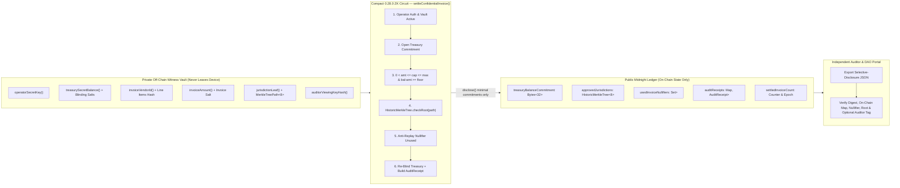
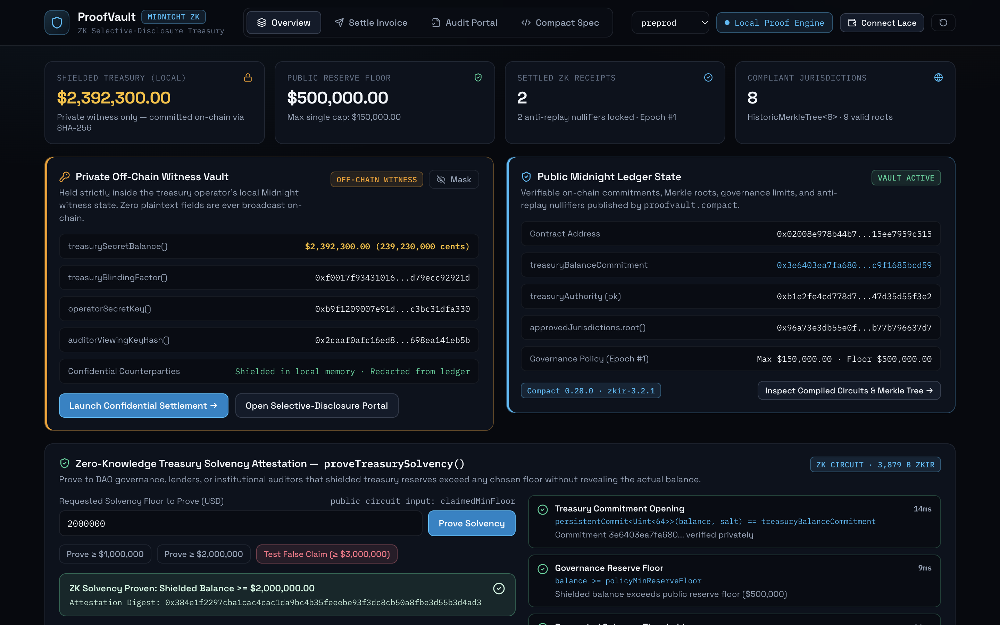

# ProofVault

**Zero-Knowledge Selective-Disclosure Treasury Compliance & Confidential Invoice / Bounty Settlement on Midnight Network**

[](./LICENSE)
[-34d399.svg)](./contracts/proofvault.compact)
[](./package.json)
[](./src/midnight/walletAdapter.ts)

> Built for **AKINDO — Build Privacy-First Apps on Midnight (Wave 3)** (`midnightntwrk`).
> **Live App (GitHub Pages):** [https://alphonshhhomenicmtu.github.io/proofvault-midnight/](https://alphonshhhomenicmtu.github.io/proofvault-midnight/)

ProofVault enables DAOs, Web3 foundations, and institutional treasuries to settle contributor bounties, security audits, and vendor invoices with **cryptographic proof of solvency, budget compliance, and non-sanctioned jurisdiction**—without exposing counterparty identities, itemized invoice scopes, exact payout figures, country codes, or total treasury balances on-chain.

Every confidential settlement writes an immutable **Selective-Disclosure Audit Receipt** to Midnight's public ledger (`AuditReceipt`), allowing external auditors and governance delegates to verify compliance claims independently while private operational data remains strictly inside the treasury's off-chain witness vault.

---

## Why Midnight? Dual-Ledger Privacy Architecture

Traditional public chains force an untenable tradeoff: either expose vendor rates, payroll, and treasury runway to competitors, or move off-chain and lose verifiable compliance. ProofVault leverages Midnight's native **dual-ledger model** and **Compact zero-knowledge circuits** to enforce compliance invariants on private witnesses before publishing only minimal cryptographic commitments.



### Privacy Boundary Matrix

| Data Field | Public Ledger Sees | Scoped Auditor Verifies | Permanently Shielded |
| --- | :---: | :---: | :---: |
| Exact Treasury Balance (`treasurySecretBalance`) | — | Solvency `>= floor` only | **Yes** |
| Exact Invoice Payout Amount (`invoiceAmount`) | — | Within `budgetTierCap` only | **Yes** |
| Counterparty Identity & Line Items | — | Commitment binding only | **Yes** |
| Exact Country / ISO Code | — | Non-sanctioned Merkle inclusion | **Yes** |
| `treasuryBalanceCommitment` (`persistentCommit`) | **Yes** | **Yes** | — |
| `usedInvoiceNullifiers` (Anti-Replay `Set`) | **Yes** | **Yes** | — |
| `approvedJurisdictions` (`HistoricMerkleTree<8>`) | Root & History | Root Validity | Leaf Preimage |
| `auditorTag` (`AuditorScoped` tier only) | Opaque Hash | **Key-Bound Scope Match** | Viewing Key |

---

## Verified Midnight Compact Contract & Toolchain

The production contract [`contracts/proofvault.compact`](./contracts/proofvault.compact) compiles cleanly with the official Midnight Compact toolchain (Ledger 9 era), producing real TypeScript bindings, ZKIR/BZKIR circuit files, and proving/verifying keys:

- **Compact Compiler (`compactc`):** `0.36.1` (`commit 7fa3a117c`)
- **Language Version:** `0.28.0` (`pragma language_version >= 0.28.0;`)
- **ZKIR Target:** `zkir-3.2.1`
- **Runtime Package:** `@midnight-ntwrk/compact-runtime@0.21.0`
- **Wallet Connector:** `@midnight-ntwrk/dapp-connector-api@4.1.0` (`window.midnight` CAIP-372 UUID discovery + `connect(networkId)` for `preprod`, `preview`, `mainnet`, and `undeployed`)

### Compiled Circuits Summary (from `contracts/managed/proofvault/compiler/contract-manifest.json`)

| Exported Circuit | ZKIR Size | BZKIR Size | Verifier Key | Prover Key | Purpose |
| --- | ---: | ---: | ---: | ---: | --- |
| `settleConfidentialInvoice` | 20,385 B | 6,159 B | 2,121 B | 43.0 MB | Atomic 7-guard confidential settlement, balance re-blinding, nullifier lock & selective-disclosure receipt |
| `proveTreasurySolvency` | 3,879 B | 998 B | 2,121 B | 10.8 MB | Zero-knowledge attestation proving committed balance exceeds reserve & requested floors |
| `registerApprovedJurisdiction` | 3,433 B | 964 B | 2,121 B | 10.8 MB | Operator-authenticated leaf insertion into `HistoricMerkleTree<8, Bytes<32>>` |
| `updateGovernancePolicy` | 3,606 B | 1,053 B | 2,121 B | 10.8 MB | Operator-authenticated governance cap/floor rotation, circuit breaker pause/resume & epoch bump |
| `verifyReceiptOnChain` | 969 B | 266 B | 1,353 B | 0.2 MB | Public verification circuit checking on-chain existence in `auditReceipts` |

---

## Application Screenshots

| Treasury & Dual-Ledger Overview | Confidential Invoice Settlement & ZK Pipeline |
| :---: | :---: |
|  |  |

| Selective-Disclosure Auditor Portal | Compact 0.28.0 Contract & Governance Inspector |
| :---: | :---: |
|  |  |

---

## Judge Quickstart & Verification

ProofVault runs in **two modes** so evaluators can verify everything immediately without installing a local Midnight node or browser extension:
1. **Local Proof Engine (Default on GitHub Pages):** Deterministic browser-native SHA-256 commitments, depth-8 `HistoricMerkleTree`, anti-replay nullifier set, and 7-point selective-disclosure receipt verifier mirroring `contracts/proofvault.compact` 1:1.
2. **Lace Wallet Mode (`@midnight-ntwrk/dapp-connector-api@4.1.0`):** Discovers injected Lace Midnight providers under `window.midnight`, requests network authorization via `connect(networkId)`, and hydrates `getConfiguration()`, `getShieldedAddresses()`, `getUnshieldedAddress()`, and `getDustAddress()`.

### 1. Install Dependencies
```bash
npm install
```

### 2. Run Automated Tests (Compiled Compact Runtime + Security + Privacy Audit)
```bash
npm test
```

The Vitest suite runs **16 automated tests across 3 suites**:
- `tests/compact-contract.test.ts` — executes the **real compiled `contracts/managed/proofvault/contract/index.js`** directly via `@midnight-ntwrk/compact-runtime@0.21.0`:
  - Vault deployment, `HistoricMerkleTree<8>` registration, and Merkle path generation
  - `proveTreasurySolvency` positive proofs and false-floor rejections
  - `settleConfidentialInvoice` across `AuditorScoped` and `MinimalSolvency` tiers + post-settlement commitment re-blinding
  - Double-settlement nullifier replay rejection (`Invoice nullifier already spent`)
  - Sanctioned / unlisted jurisdiction Merkle proof rejection
  - Unauthorized operator, budget tier cap violation, governance ceiling breach, reserve floor violation, and paused vault circuit breaker
  - **On-Chain Serialized State Privacy Audit** proving raw operator keys, vendor IDs, line items, and salts never appear in `contractState.serialize()`
- `tests/proof-engine.test.ts` — validates browser circuit-equivalence engine, all 6 UI presets (3 valid + 3 negative security guards), exported receipt JSON zero-PII checks, tampered receipt detection, and wrong auditor key detection
- `tests/wallet-adapter.test.ts` — validates CAIP-372 UUID `window.midnight` discovery, Lace v4.1 session connection, and graceful fallback

### 3. Re-Compile the Compact Smart Contract (Optional — Pre-Compiled Artifacts Included)
```bash
# Install Midnight Compact CLI if not already installed:
curl --proto '=https' --tlsv1.2 -LsSf https://github.com/midnightntwrk/compact/releases/latest/download/compact-installer.sh | sh
compact update 0.36.1

# Fast TypeScript + ZKIR compilation:
npm run compile:contract:fast

# Full compilation including ZKIR proving & verifying keys:
npm run compile:contract
```

### 4. Run the Frontend Locally or Build Static Bundle for GitHub Pages
```bash
npm run dev       # Local dev server at http://localhost:5173
npm run build     # Type-checks and outputs static GitHub Pages bundle to dist/
npm run preview   # Serves production dist/ bundle at http://localhost:4173
```

---

## Repository Structure

```text
├── contracts/
│   ├── proofvault.compact                 # Midnight Compact 0.28.0 ZK smart contract
│   └── managed/proofvault/                # Real compactc 0.36.1 compiled outputs
│       ├── compiler/                      # contract-info.json & contract-manifest.json
│       ├── contract/                      # Compiled index.js, index.d.ts, source map
│       └── zkir/                          # Compiled .zkir & .bzkir circuits for all 5 circuits
├── docs/
│   ├── PITCH_DECK.md                      # 9-slide Wave 3 pitch deck outline
│   └── screenshots/                       # 4 Retina UI verification screenshots
├── src/
│   ├── midnight/
│   │   ├── types.ts                       # Dual-ledger & selective-disclosure TypeScript types
│   │   ├── proofEngine.ts                 # Browser cryptographic circuit-equivalence engine & verifier
│   │   ├── walletAdapter.ts               # @midnight-ntwrk/dapp-connector-api v4.1 Lace connector
│   │   ├── presets.ts                     # Seeded treasury vault & 6 interactive demo scenarios
│   │   └── compactSource.ts               # Compiled circuit metadata & source bindings
│   ├── components/
│   │   ├── OverviewTab.tsx                # Dual-ledger split workbench & solvency prover
│   │   ├── SettleTab.tsx                  # Confidential invoice settlement & 6-stage ZK pipeline
│   │   ├── AuditTab.tsx                   # Selective-disclosure receipt verifier & tamper tester
│   │   └── CompactSpecTab.tsx             # Compiler stats, Merkle registry, governance & source
│   ├── App.tsx
│   ├── main.tsx
│   └── styles.css
├── tests/
│   ├── compact-contract.test.ts           # Real compiled Compact runtime integration & privacy tests
│   ├── proof-engine.test.ts               # Browser engine & selective-disclosure verifier tests
│   └── wallet-adapter.test.ts             # Lace v4.1 DApp Connector unit tests
├── SPEC.md                                # Wave 3 judging rubric & technical specification
└── LICENSE                                # Apache License 2.0
```

---

## 2-Minute Demo Walkthrough Script

- **0:00–0:20 | The Privacy Dilemma & Overview (`Overview` tab):**
  Show the split **Private Off-Chain Witness Vault** (amber boundary: `$2,392,300` exact shielded balance, blinding salt, operator secret key) side-by-side with the **Public Midnight Ledger State** (cyan boundary: only `treasuryBalanceCommitment`, `approvedJurisdictions` `HistoricMerkleTree<8>` root, governance ceiling, and reserve floor). Click **Mask** to demonstrate off-chain privacy, then click **Prove >= $2,000,000** to execute `proveTreasurySolvency()` and generate an on-chain solvency attestation without exposing the exact balance; click **Test False Claim (>= $3,000,000)** to watch the circuit reject an unprovable claim.
- **0:20–1:00 | Confidential Invoice Settlement & Guard Tests (`Settle Invoice` tab):**
  Select **ZK Security Audit Bounty (CH)** (`$42,500` under a `$50,000` cap, `AuditorScoped`) and click **Execute ZK Settlement Circuit**. Point out the 6 passing ZK constraint stages, the newly published `receiptId`, `nullifier`, and re-blinded `nextTreasuryBalanceCommitment`, and the amber **Redacted Off-Chain Witnesses** list proving vendor identity, line items, country, and exact amount never hit the chain. Next, click **Sanctioned Jurisdiction Test (KP)** and **Double-Settlement Replay Test** to show both attacks rejected cleanly before touching ledger state.
- **1:00–1:35 | Independent Selective-Disclosure Verification (`Audit Portal` tab):**
  Click **Audit Receipt →** to jump directly to the Auditor Portal. Highlight the 7/7 passing cryptographic checks (including `Auditor Viewing Key Scope Binding`). Click **Test Wrong Auditor Key** to show unauthorized auditors fail scoped binding, then click **Simulate Tampered Cap** to prove any post-hoc edit to a receipt JSON breaks on-chain immutability verification. Restore and export the clean zero-PII JSON receipt.
- **1:35–2:00 | Compiled Compact 0.28.0 Artifacts & Lace Readiness (`Compact Spec` tab):**
  Open **Compact Spec** to show the real `compactc 0.36.1` (`zkir-3.2.1`) compiled circuit table, insert a new compliant jurisdiction (`FR` — France) into the live `HistoricMerkleTree`, toggle the governance circuit breaker, and point out the `Connect Lace` (`@midnight-ntwrk/dapp-connector-api@4.1.0`) selector in the header.

---

## License

Licensed under the **Apache License, Version 2.0**. See [`LICENSE`](./LICENSE) for full terms.
